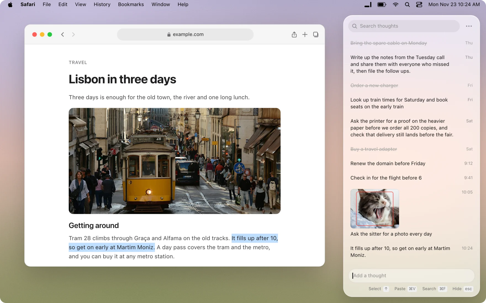
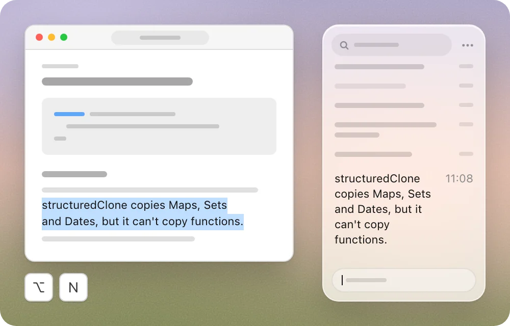
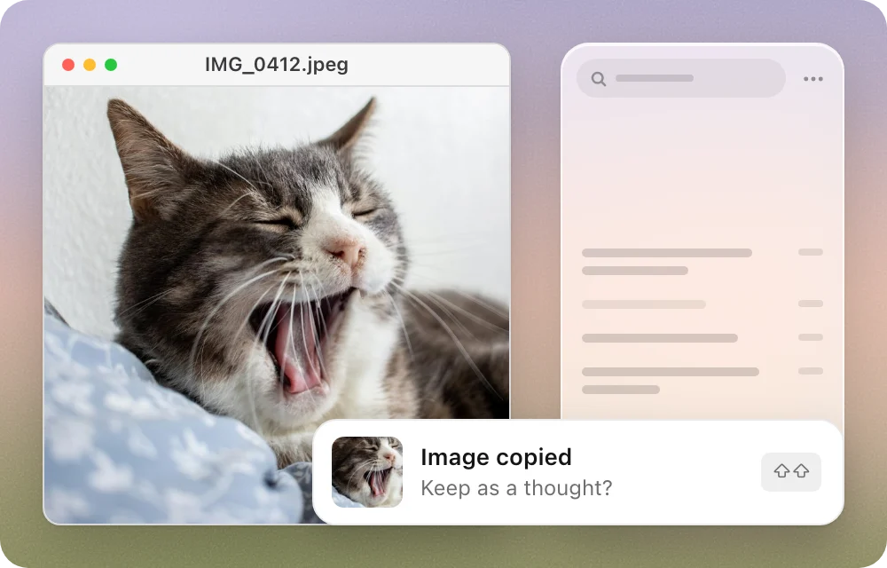
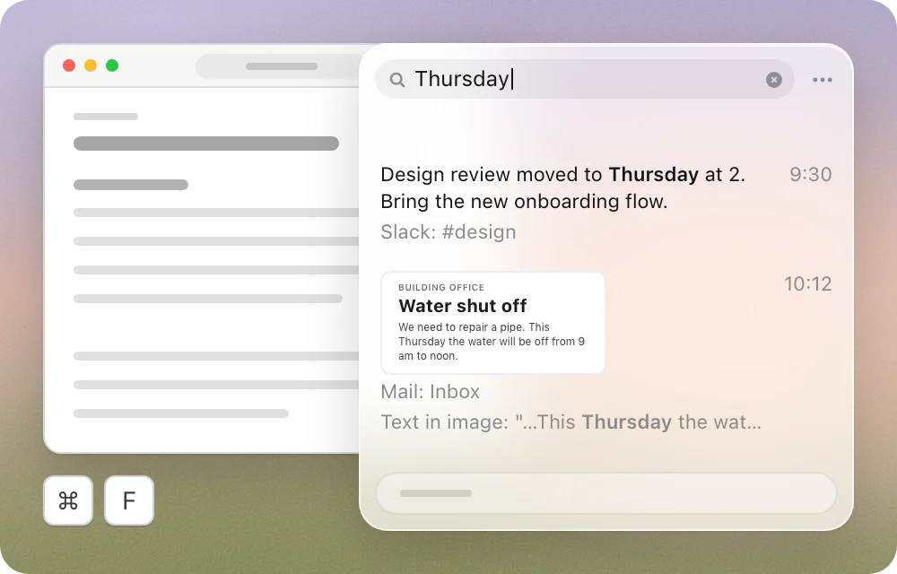
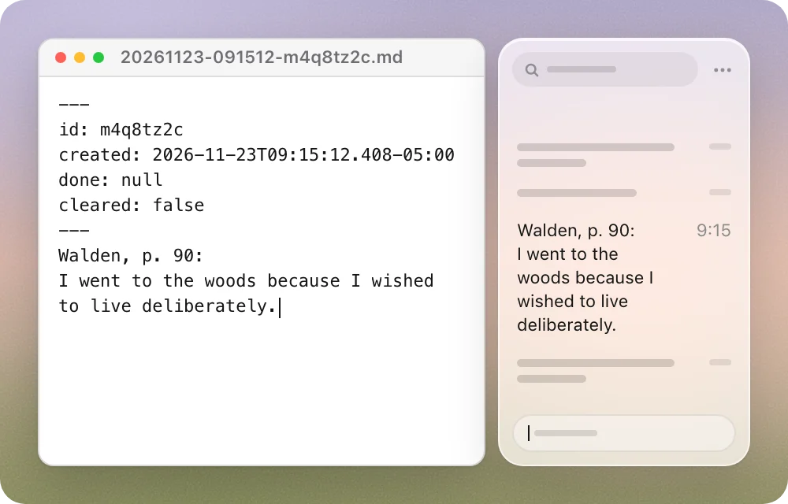
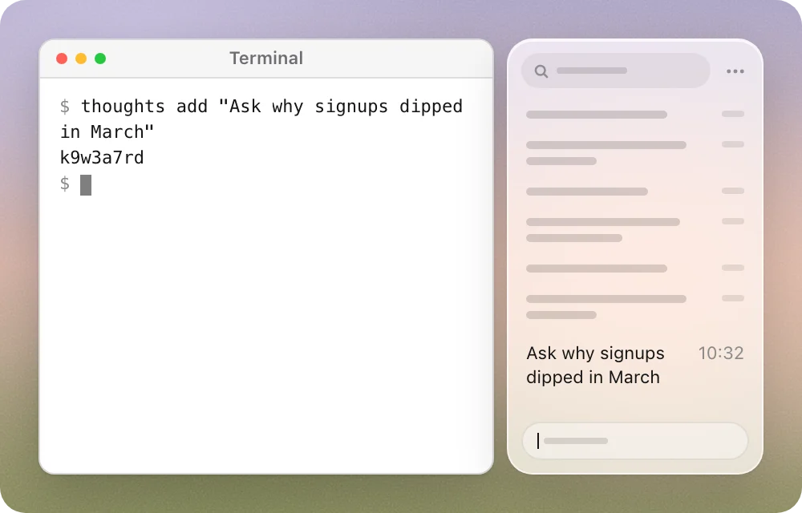
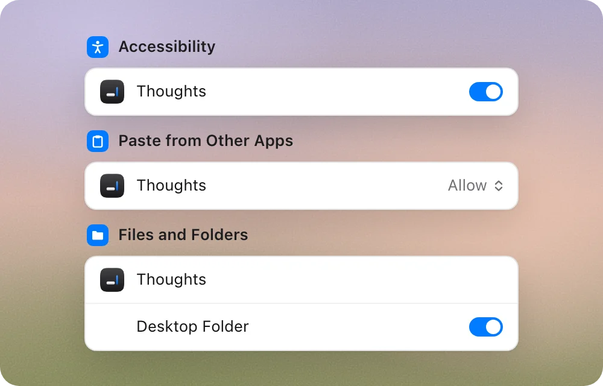

<p align="center">
  <picture><source media="(prefers-color-scheme: dark)" srcset=".github/images/icon-dark.webp"></picture>
</p>

<h1 align="center">Thoughts</h1>

<p align="center">
  Thoughts is a quiet place for what you find while you work.<br>
  Press ⌥N in any app to open the panel, or select text and press Shift twice to save it.
</p>

<p align="center">
  <a href="https://github.com/HlaKarki/thoughts/releases/latest/download/Thoughts.zip"><picture><source media="(prefers-color-scheme: dark)" srcset=".github/images/download-dark.webp"></picture></a>
</p>

<p align="center">
  Or install it with Homebrew: <code>brew install --cask hlakarki/tap/thoughts</code><br>
  <sub>Needs macOS 15.4 or later. More at <a href="https://thoughts.hla.dev">thoughts.hla.dev</a>.</sub>
</p>

<picture><source media="(prefers-color-scheme: dark)" srcset=".github/images/hero-dark.webp"></picture>

## Save it in the app where you found it

Find it later in one list. Text, todos and screenshots from any app go to one list at the edge of your screen, and each one is a Markdown file. Saved text keeps the app and window it came from, so you can go back to it.

<table>
<tr>
<td width="50%" valign="top">
<h3>Press Shift twice to keep a selection</h3>
<p>Select or copy text in any app and press Shift twice. Thoughts saves it with the app and window it came from, and a note at the edge of the screen shows what it saved.</p>
<picture><source media="(prefers-color-scheme: dark)" srcset=".github/images/selection-dark.webp"></picture>
</td>
<td width="50%" valign="top">
<h3>Keep a copied image with a click</h3>
<p>Copy an image or take a screenshot, and a small offer slides in at the edge of the screen. Click it or press Shift twice to keep the image as a thought.</p>
<picture><source media="(prefers-color-scheme: dark)" srcset=".github/images/screenshot-dark.webp"></picture>
</td>
</tr>
<tr>
<td width="50%" valign="top">
<h3>Press ⌘F to search your thoughts</h3>
<p>Start typing and the list narrows to the thoughts that match, including the text inside screenshots. Esc clears the search.</p>
<picture><source media="(prefers-color-scheme: dark)" srcset=".github/images/search-dark.webp"></picture>
</td>
<td width="50%" valign="top">
<h3>Every thought is a Markdown file</h3>
<p>Each thought is one Markdown file in a folder you choose. Edit the file in any editor and the panel shows the change.</p>
<picture><source media="(prefers-color-scheme: dark)" srcset=".github/images/markdown-dark.webp"></picture>
</td>
</tr>
<tr>
<td width="50%" valign="top">
<h3>Your agents can add thoughts too</h3>
<p>The <code>thoughts</code> command uses the same folder as the app, so a script can run <code>thoughts add</code>. Add <code>thoughts mcp</code> to an MCP client and your agent can list, add and search thoughts.</p>
<picture><source media="(prefers-color-scheme: dark)" srcset=".github/images/agents-dark.webp"></picture>
</td>
<td width="50%" valign="top">
<h3>What Thoughts asks macOS for</h3>
<p>Accessibility lets Thoughts read what you select and the window title. macOS 27 calls it Device Control and Data Access. Paste access lets Thoughts read what you copy, so Shift twice can save it and an offer can show a preview. macOS asks for it the first time Thoughts needs it. Thoughts asks for your screenshot folder, the Desktop by default, only if macOS guards it. It goes online only to check for updates.</p>
<picture><source media="(prefers-color-scheme: dark)" srcset=".github/images/privacy-dark.webp"></picture>
</td>
</tr>
</table>

## Install

Thoughts needs macOS 15.4 or later.

Install it with Homebrew:

```sh
brew install --cask hlakarki/tap/thoughts
```

The cask also puts the `thoughts` command line tool on your `PATH`.

You can also [download Thoughts.zip](https://github.com/HlaKarki/thoughts/releases/latest/download/Thoughts.zip) from the latest release, unzip it and move Thoughts.app to your Applications folder. The command line tool is inside the app. To run it from a shell, link it into a folder on your `PATH`:

```sh
sudo ln -s /Applications/Thoughts.app/Contents/Helpers/thoughts /usr/local/bin/thoughts
```

Thoughts checks for updates once a day. When one is ready, "Update available" appears in the ⋯ menu and in the menu bar icon's menu, and the icon's caret turns blue. You can also choose "Check for updates…" in either menu. The update check is the only network request Thoughts makes.

## First run

The first time Thoughts opens, it walks you through five steps.

1. **Pick a key to open Thoughts.** The default is ⌥N. Press it in any app to show or hide the panel. You can also choose Show Thoughts from the Thoughts icon in the menu bar.
2. **Pick how to save from any app.** Press Shift twice, or record your own shortcut. It saves the selected text, or what you just copied, as a thought.
3. **Turn on Thoughts in System Settings.** Thoughts asks for Accessibility, which macOS 27 calls Device Control and Data Access, so the capture works in other apps. It reads the text you select and the title of the window you're in, so each thought records where it came from. The step shows when Thoughts is waiting for the switch and moves on once you turn it on.
4. **Choose where thoughts are saved.** The default is `~/Thoughts`. Thoughts makes the folder if it isn't there. A folder inside iCloud Drive or Dropbox syncs to your other Macs.
5. **Keep the images you copy.** When you copy an image, a small offer appears at the edge of the screen. Click it, or press your capture key, to keep it. Thoughts also offers new images saved in your screenshot folder, which is the Desktop unless you changed it. That is why macOS may ask for access to that folder at this step.

The first time Thoughts reads something you copied, macOS asks if it can paste from other apps. Choose Allow Paste, so Shift twice can save the copy and offers show a preview of the image. You can change this later in System Settings under Privacy & Security, Paste from Other Apps.

Thoughts never asks for Input Monitoring.

## The panel

The panel opens at the right edge of the screen. To move it, drag it by an empty part. Drop it near the left or right edge and it snaps there, or leave it anywhere else on the screen. Thoughts remembers where you put it. Click outside the panel or press Esc to hide it.

## Menu bar icon

Thoughts lives in the menu bar with no Dock icon and waits until you call it. The menu bar icon is on by default. Its menu has Show Thoughts, Settings…, Check for updates… and Quit Thoughts. To remove it, turn off "Show Thoughts in the menu bar" in Settings or Command-drag it out of the menu bar. The summon key, or opening Thoughts again from Applications, still shows the panel.

## Settings

Open Settings from the ⋯ menu or the menu bar icon, or press ⌘, while the panel is open. There you can change:

- The summon key and the capture gesture.
- Whether Thoughts offers to keep copied images, and which folders it watches for new images.
- Whether a sound plays when a thought is saved.
- The storage folder.
- The menu bar icon, and whether Thoughts opens at login.

Settings also shows whether Thoughts may paste from other apps: Allowed, Blocked or Asks permission. Until it says Allowed, the Open Privacy & Security button takes you to the page in System Settings where you can change it.

## Keys

Thoughts works from the keyboard. Two keys work in any app, and the rest work in the panel. Press ⌘K with a thought selected to see every action you can take on it.

Anywhere:

| Key | What it does |
| --- | --- |
| ⌥N | Show or hide the panel. Change it in Settings. |
| Shift twice, or your shortcut | Save the selected text, or what you copied in the last 2 minutes, as a thought. |

In the panel:

| Key | What it does |
| --- | --- |
| Return | Add what you typed as a thought. |
| ↑ | Select the newest thought, when the field is empty. |
| ⌘F | Search thoughts. Esc clears the search. |
| ⌘Z, ⇧⌘Z | Undo or redo your last change: a delete, Clear done, done or not done, or a saved edit. Typing in a field counts too. |
| Esc | Hide the panel, or remove an attached image first. |

With a thought selected:

| Key | What it does |
| --- | --- |
| ↑ ↓ | Move the selection. Hold Shift to select more than one. |
| Return | Edit the text. Return saves and Esc cancels. |
| ⌘Return | Mark done, or mark not done. |
| Space | Preview the thought. |
| ⌘C | Copy. |
| ⇧⌘C | Copy the file path. |
| ⌘O | Open the original: the page or app it came from. |
| ⌘R | Show in Finder. |
| ⌘⌫ | Delete. The file goes to the Trash, and ⌘Z puts it back. |
| ⌘K | Show every action for the selection. |
| Esc | Go back to the text field. |

You can also drop text, images or files on the panel. Images and text are saved as they are, and any other file is saved as its path. In other apps, choose "Add to Thoughts" in the Share menu.

## Your files

Thoughts saves to `~/Thoughts` unless you picked another folder. To move it, open Settings from the ⋯ menu or the menu bar icon and change the storage folder. Thoughts moves the files and leaves a link at the old path.

Each thought is one Markdown file named after the time it was saved and its ID. A screenshot is a PNG with the same name, next to its Markdown file. A thought saved from a web page looks like this:

`20261122-181403-ke6s0pcg.md`

```markdown
---
id: ke6s0pcg
created: 2026-11-22T18:14:03.120-05:00
done: null
cleared: false
source:
  app: Safari
  bundle: com.apple.Safari
  window: Keyboard navigation guide
  url: https://example.com/guide
  title: Keyboard navigation guide
---
Read the section on keyboard navigation again
```

`done` holds the time you marked the thought done. `cleared` turns true when "Clear done" in the ⋯ menu hides it from the panel. A screenshot thought adds `image:` with the PNG's file name, and its note is the body.

You can edit the files in any editor, and the panel picks up the change. Thoughts keeps any front matter keys it doesn't know. The search index in `~/Library/Application Support/Thoughts` is a cache that Thoughts rebuilds from the files.

## Command line and MCP

The `thoughts` tool reads and writes the same folder as the app.

| Command | What it does |
| --- | --- |
| `thoughts list` | List thoughts, open ones by default. Add `--done` or `--all` to see more. |
| `thoughts add <text>` | Add a thought from text. `--image <file>` adds a screenshot thought, with `--note <text>`. With no text, it reads text piped to it. |
| `thoughts show <id>` | Show one thought. |
| `thoughts path <id>` | Print the file path of a thought, or of its image. |
| `thoughts done <id>` | Mark a thought done. `--undo` opens it again. |
| `thoughts search <words>` | Search thoughts, including text in screenshots. |
| `thoughts mcp` | Serve thoughts over MCP on standard input and output. |

An ID can be the first 4 or more characters of one. Add `--json` to `list`, `add`, `show`, `done` or `search` for JSON output. Set `THOUGHTS_DIR` to use another folder.

`thoughts mcp` gives an MCP client six tools: `list_thoughts`, `add_thought`, `show_thought`, `thought_path`, `mark_done` and `search_thoughts`. Thoughts added through MCP record the client's name as their source. To add it to an MCP client that reads an `mcpServers` config:

```json
{
  "mcpServers": {
    "thoughts": {
      "command": "/Applications/Thoughts.app/Contents/Helpers/thoughts",
      "args": ["mcp"]
    }
  }
}
```

## Building from source

You need Xcode 26.6 or later and [XcodeGen](https://github.com/yonaskolb/XcodeGen).

```sh
git clone https://github.com/HlaKarki/thoughts.git
cd thoughts
xcodegen generate
mkdir -p Thoughts.xcodeproj/project.xcworkspace/xcshareddata/swiftpm
cp Config/Package.resolved Thoughts.xcodeproj/project.xcworkspace/xcshareddata/swiftpm/
xcodebuild -project Thoughts.xcodeproj -scheme Thoughts -configuration Debug build
```

Copying `Config/Package.resolved` pins the package versions the project was tested with. Without a team the app signs ad hoc. To sign with your own team, copy `Config/Local.xcconfig.example` to `Config/Local.xcconfig` and set `DEVELOPMENT_TEAM`.

A Debug build is named Thoughts Dev. It keeps its own folder, `~/Thoughts Dev`, and its own settings, so it never touches an installed copy of Thoughts.

## License

Thoughts is released under the [MIT License](LICENSE).
